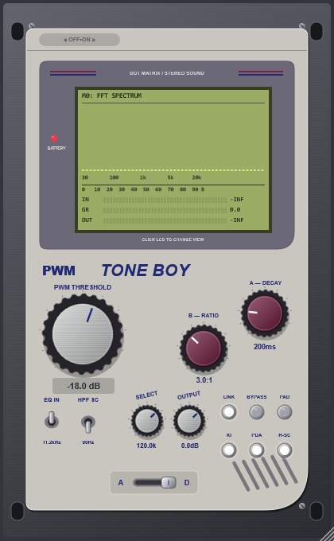
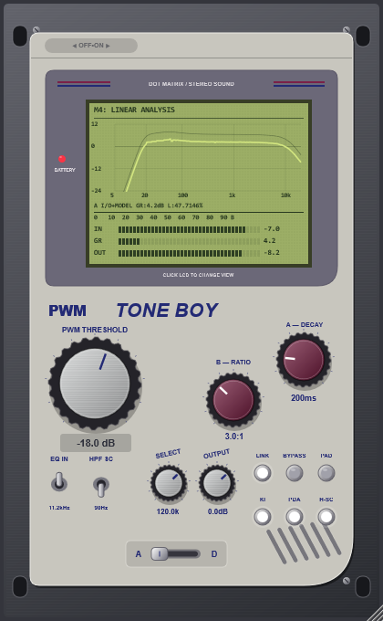

# PWM TONE BOY — PAPIELGUAPO

**v1.4.0 · A con variación real de audio; D digital limpio y auditoría documentada.**



- **[Descargar VST3 + Standalone — Windows x64](https://github.com/papielguapo/PWMToneBoy/releases/download/v1.4.0/PWM-TONE-BOY-Windows-x64.zip)**
- **[Guía completa en español](docs/GUIA-ES.md)**
- **[Auditoría v1.4.0: hallazgos, correcciones, medidas y límites](docs/AUDITORIA-v1.4.0.md)**

## A cambia la señal, no solo la LCD

A aplica una variación lenta y acotada a sus coeficientes de filtros y a una ganancia muy leve. Es procesamiento real, medible sin crear editor y en un analizador externo. La fase no se rebobina con reset/prepare de una instancia existente. El DAC sigue desactivado; no hay hiss, hum, dither ni ruido aleatorio añadido.

Esta variación **sí crea algo de modulación y bandas laterales**: es una consecuencia del procesamiento real, no una animación. Los niveles y las limitaciones están medidos en la auditoría. No se afirma que sea un circuito Crane Song reconstruido ni una deriva térmica calibrada.



## D conserva su comportamiento limpio

D omite la rama de color/deriva de A. KI sigue independiente, con su segundo armónico sutil; PDA y H-SC actúan sobre dinámica/detección. Las referencias normales de D de v1.2.1 se conservan. Cero de entrada desde reposo produce cero exacto de salida en A y D.

La auditoría corrige además muestras NaN/Inf antes del oversampling, metadatos de preparación inválidos y la dependencia del control A del tamaño de bloque. No se añade distorsión ni deriva a la ruta digital normal.


## Comprobado

**3.935 aserciones sin fallos y pluginval nivel 10 superado.** Medidas sin editor, 48 kHz, seno 0.2 pico, ratio 1:1, umbral 0 dB, KI OFF, dos segundos de asentamiento y cuatro medidos:

| Frecuencia | Variación pico a pico de A | Variación de D |
|---|---:|---:|
| 64 Hz | 0.046041 dB | <0.0001 dB |
| 1000 Hz | 0.009870 dB | <0.0001 dB |
| 8000 Hz | 0.028901 dB | <0.0001 dB |

El conteo incluye puntos de barridos, no miles de escenarios de host independientes. No es una certificación de ausencia de fallos o de equivalencia con hardware. Los datos y registros están en QA dentro del ZIP.

## Funciones que se conservan

THRESHOLD −42 a 0 dB; RATIO 1/2/3/5/10/20/100; DECAY 100–3200 ms; OUTPUT −24 a +12 dB. Auto-Gain sigue activo, con EQ IN, HPF SC, LINK, BYPASS, PAD, KI, PDA, H-SC y A/D. El editor mantiene la skin y la escala 80–200%. Standalone ofrece bucles internos y WAV/AIFF. SELECT/DAC y ProSound permanecen desactivados en audio.

La LCD conserva seis vistas. M4 combina modelo y transferencia observada en A; D conserva su vista normal. M5 muestra espectro con música y solo añade THD/THD+N con un tono válido. No se inyectan tonos automáticamente.

Diseño original inspirado en comportamiento analógico/STC-8. Fabricante PAPIELGUAPO; IDs y parámetros conservados; latencia de 6 muestras. OUTPUT está después del protector: una ganancia positiva puede superar 0 dBFS.

## Compilar

C++20, CMake 3.22+, JUCE 8.0.4 vía FetchContent si no hay JUCE 8 local. Windows requiere Visual Studio con C++ y Windows SDK.

```powershell
cmake -B build -DCMAKE_BUILD_TYPE=Release
cmake --build build --config Release --parallel
& 'build/PWMToneBoyChecks_artefacts/Release/PWMToneBoyChecks.exe' QA
```

Artefactos: `build/PWMToneBoy_artefacts/Release/VST3/PWM TONE BOY.vst3` y `build/PWMToneBoy_artefacts/Release/Standalone/PWM TONE BOY.exe`. Copia el bundle VST3 completo. Los ZIP incluyen guía, auditoría, imágenes, registros y fuentes según el paquete. La licencia de JUCE se descarga en `build/_deps/juce-src`.
