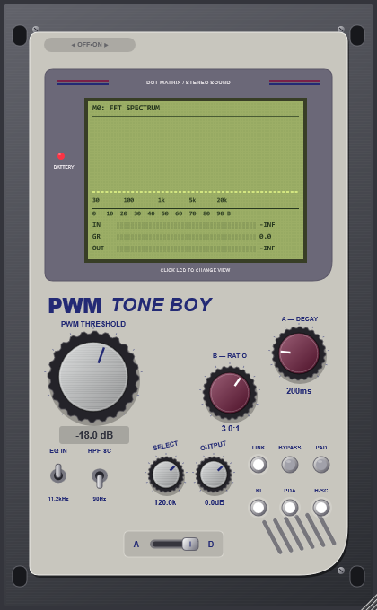
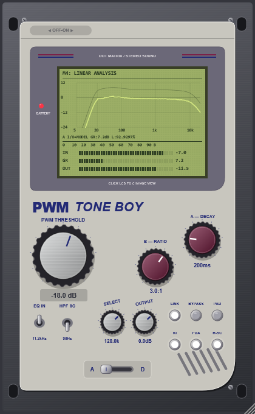
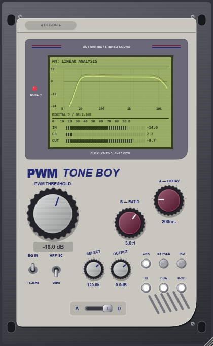

# PWM TONE BOY — PAPIELGUAPO

**Compresor estéreo con color armónico · Windows x64 · VST3 + Standalone · v1.4.4**

**Selector de abajo: A = ANALOG (analógico), D = DIGITAL (digital).** A aporta color y variación real; D omite esa rama y mantiene la ruta más limpia. KI es independiente. Ratio y DECAY por pasos. Recuperación corregida para que el compresor pueda volver entre golpes.



- **[Descargar VST3 + Standalone — Windows x64](https://github.com/papielguapo/PWMToneBoy/releases/download/v1.4.4/PWM-TONE-BOY-Windows-x64.zip)**
- **[Guía completa en español](docs/GUIA-ES.md)**
- **[Auditoría base y hallazgos](docs/AUDITORIA-v1.4.2.md)**
- **[Corrección del analizador y pruebas de v1.4.3](docs/CORRECCION-ANALIZADOR-v1.4.3.md)**
- **[Ficha técnica](docs/FICHA-TECNICA.md)**
- **[Dinámica, LIM y nuevas posiciones: pruebas v1.4.4](docs/DINAMICA-v1.4.4.md)**

## Nuevo selector de ratio y recuperación

**1:5.0 → 1:3.0 → 1:2.0 → 1:1 → 2:1 → 3:1 → 5:1 → 10:1 → LIM**

Las tres primeras posiciones son **expansión hacia arriba**, como la curva solicitada: por cada dB adicional por encima del umbral, la salida sube 5, 3 o 2 dB, fuera de la rodilla y antes del límite de realce (+24 dB). No son compresión ascendente UP. 20:1 se retira; INF se sustituye por **LIM**, con pendiente estacionaria plana y ataque nominal de 0,1 ms.

La recuperación usa una sola etapa principal en ganancia, con memoria del programa acotada, en vez de encadenar dos recuperaciones largas. Se conserva el modelo de color A; cambia la dinámica que lo alimenta. [Mediciones antes/después y criterios](docs/DINAMICA-v1.4.4.md).

**Sesiones antiguas:** sus posiciones de ratio se convierten al cargar; 20:1 se aproxima a 10:1 e INF pasa a LIM. **Revisa o reasigna la automatización antigua de RATIO**, porque la escala normalizada del host cambia al pasar de siete a nueve posiciones. Un punto antiguo de 1:1 podría seleccionar una expansión si se reproduce sin revisar.

## Cómo empezar en dos minutos

1. Inserta PWM TONE BOY en una pista o bus. Conserva margen en entrada y salida.
2. En el **selector horizontal de abajo**, elige **D = DIGITAL** para empezar con una ruta más limpia, o **A = ANALOG (analógico)** para el color y la variación real de A. **A está a la izquierda; D, a la derecha.** Este selector es distinto de la perilla superior A — DECAY.
3. Empieza con **RATIO 3:1** y **DECAY 200 ms**. Baja THRESHOLD hasta ver aproximadamente 1–3 dB de GR en las partes fuertes. Es un punto de partida, no un objetivo obligatorio.
4. Ajusta **OUTPUT** para que al activar BYPASS el volumen resulte parecido. Auto-Gain no lo iguala por sí solo.
5. Compara **KI** encendido y apagado. Si quieres menos influencia del grave en la compresión, prueba **HPF SC**. Para más parte alta, compara **EQ IN** apagado (20 kHz) frente a encendido (11,2 kHz).
6. Haz clic en la pantalla verde para recorrer sus seis vistas. **M4 = Linear Analysis**; **M5 = Harmonic Analysis**. Cambiar de pantalla no cambia el sonido.

Arrastra las perillas para ajustar; **doble clic en la perilla restaura su valor inicial**. En esta versión no se escriben valores por doble clic. Las tres posiciones 1:5/1:3/1:2 sí expanden hacia arriba; no hay menús EXP/UP. Las lámparas blancas indican activado; BYPASS activado significa señal seca.

**Corregido en v1.4.3:** el analizador ya supera la prueba a 176,4/192 kHz, incluido el timer JUCE real a 192 kHz. [Corrección y pruebas](docs/CORRECCION-ANALIZADOR-v1.4.3.md). Las colas siguen siendo finitas ante bloqueos largos de GUI.

## A cambia la señal, no solo la LCD

A aplica una variación lenta y acotada a sus coeficientes de filtros y a una ganancia muy leve. Es procesamiento real, medible sin crear editor y en un analizador externo. La fase no se rebobina con reset/prepare de una instancia existente. El DAC sigue desactivado; no hay hiss, hum, dither ni ruido aleatorio añadido.

Esta variación **sí crea algo de modulación y bandas laterales**: es una consecuencia del procesamiento real, no una animación. Los niveles y las limitaciones están medidos en la auditoría. No se afirma que sea un circuito Crane Song reconstruido ni una deriva térmica calibrada.



## D conserva su comportamiento limpio

D omite la rama de color/deriva de A. KI sigue independiente, con su segundo armónico sutil; PDA y H-SC actúan sobre dinámica/detección. Las referencias normales de D de v1.2.1 se conservan. Cero de entrada desde reposo produce cero exacto de salida en A y D.

La auditoría corrige además muestras NaN/Inf antes del oversampling, metadatos de preparación inválidos y la dependencia del control A del tamaño de bloque. No se añade distorsión ni deriva a la ruta digital normal.



## Comprobado

**3.505 aserciones sin fallos y pluginval nivel 10 superado.** Medidas sin editor, 48 kHz, seno 0.2 pico, ratio 1:1, umbral 0 dB, KI OFF, dos segundos de asentamiento y cuatro medidos:

| Frecuencia | Variación pico a pico de A | Variación de D |
|---|---:|---:|
| 64 Hz | 0.046399 dB | <0.0001 dB |
| 1000 Hz | 0.009980 dB | <0.0001 dB |
| 8000 Hz | 0.028815 dB | <0.0001 dB |

El conteo incluye puntos de barridos, no miles de escenarios de host independientes. No es una certificación de ausencia de fallos o de equivalencia con hardware. Los datos y registros están en QA dentro del ZIP.

## Funciones que se conservan

THRESHOLD −42 a 0 dB; nueve posiciones de RATIO; DECAY 100–3200 ms; OUTPUT −24 a +12 dB. Auto-Gain se aplica en compresión/LIM y es 0 dB fijo en las tres expansiones. EQ IN, HPF SC, LINK, BYPASS, PAD, KI, PDA, H-SC y A/D permanecen. Editor reescalable y seis vistas LCD. SELECT/DAC y ProSound siguen desactivados en audio.

La LCD conserva seis vistas. M4 combina modelo y transferencia observada en A; D conserva su vista normal. M5 muestra espectro con música y solo añade THD/THD+N con un tono válido. No se inyectan tonos automáticamente.

Diseño original inspirado en comportamiento analógico/STC-8. Fabricante PAPIELGUAPO; IDs y parámetros conservados; latencia de 6 muestras. OUTPUT está después del protector: una ganancia positiva puede superar 0 dBFS.

## Compilar

C++20, CMake 3.22+, JUCE 8.0.4 vía FetchContent si no hay JUCE 8 local. Windows requiere Visual Studio con C++ y Windows SDK.

```powershell
cmake -B build -DCMAKE_BUILD_TYPE=Release
cmake --build build --config Release --parallel
& 'build/PWMToneBoyChecks_artefacts/Release/PWMToneBoyChecks.exe' QA
```

Artefactos: `build/PWMToneBoy_artefacts/Release/VST3/PWM TONE BOY.vst3` y `build/PWMToneBoy_artefacts/Release/Standalone/PWM TONE BOY.exe`. Copia el bundle VST3 completo. Los ZIP incluyen guía, auditoría, imágenes, registros y fuentes según el paquete. La licencia de JUCE se descarga en `build/_deps/juce-src`.
