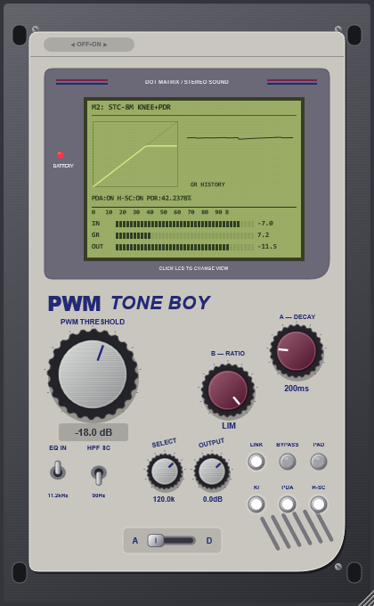

# Dinámica, expansiones y LIM — v1.4.4

**15 de noviembre de 2026 · PAPIELGUAPO**

## Qué cambia

Se corrige la recuperación que mantenía mucha reducción entre golpes de batería. Antes se encadenaban una envolvente lenta ampliada hasta 3,5× y otra recuperación de ganancia ampliada hasta 4×. Ahora hay una etapa principal de recuperación en ganancia, con constante DECAY y extensión de memoria acotada a un 15%. El detector estabiliza picos durante 12 ms y después cae con una constante corta de 25 ms. El ataque de compresión actúa sobre la ganancia una sola vez: nominal 2,2 ms, acortable con PDA hacia 0,35 ms.

El objetivo es volver entre golpes con DECAY corto, no añadir saturación para simular más compresión. Con mucha reducción aún puede existir atenuación durante buena parte del loop; el resultado depende del material y del umbral.

## Orden exacto del selector

**1:5.0 → 1:3.0 → 1:2.0 → 1:1 → 2:1 → 3:1 → 5:1 → 10:1 → LIM**

Las tres primeras posiciones son expansiones **por encima del umbral**, conforme a la curva solicitada. Fuera de la rodilla de 3 dB, una subida de entrada de 1 dB da 5, 3 o 2 dB más de salida, antes del límite de realce de +24 dB. Por debajo del umbral no levantan especialmente las partes débiles: **no son compresión ascendente UP**. No se añaden menús de modos separados.

20:1 se elimina. INF pasa a **LIM**, una curva con pendiente estacionaria cero por encima de la rodilla, con ataque nominal de 0,1 ms. No es solo cambiar el texto de 100:1. No lleva lookahead ni garantiza un techo true-peak; el OUTPUT manual sigue después de la protección de picos existente.

La compensación fija de ganancia es cero en las tres expansiones. En compresión mantiene la fórmula por umbral/ratio; LIM usa pendiente de reducción 1. La indicación G+ representa realce cuando domina sobre la reducción.




## Mediciones sobre el procesador real

Regresión completa: **3.505 aserciones, cero fallos**, con capturas. La cantidad de aserciones cambia respecto a la versión anterior porque se sustituyen puntos del barrido de ratios por las nuevas pruebas; no representa un número de escenarios independientes. Pluginval nivel 10, semilla 1472 y timeout 60000 ms, aprobado.

| Prueba | Resultado |
|---|---:|
| Entrada estable +6,0206 dB, ratio 10:1 | Salida +0,599175 dB |
| La misma subida en LIM | Salida +0,000005 dB, aproximadamente plana |
| Expansión 1:5 | Pendiente medida 5 |
| Expansión 1:3 | Pendiente medida 3 |
| Expansión 1:2 | Pendiente medida 2 |
| Primer milisegundo, escalón de entrada: LIM / 10:1 | 7,963 / 2,574 dB de reducción |
| Tono severo y 300 ms de silencio: DECAY 100 / 800 ms | 4,383 / 24,555 dB de reducción restante |

Los ensayos de pendiente usan seno de 1 kHz a 48 kHz, modo D y KI apagado, tras asentamiento. Las comparaciones 10:1/LIM usan amplitudes pico 0,3 y 0,6, umbral −18 dB y detector híbrido; las expansiones usan 0,16 y 0,175 con H-SC apagado y sin alcanzar el tope de realce. No son capturas del Kramer PIE ni de hardware. El ensayo del primer milisegundo usa un escalón de 0,25, H-SC/KI apagados y umbral −18 dB; no es una medición de true-peak.

### Loop sintético que reproduce la queja

Batería sintética con bombo, ruido de caja y hats, 48 kHz, ratio 10:1 y DECAY 100 ms. Se genera durante cinco segundos y se mide el último segundo y el silencio posterior. **No es el audio del usuario**. GR incluye la acción del protector de picos si interviene.

| THRESHOLD | Antes: GR mín./media/máx. | Ahora: GR mín./media/máx. | Tras 300 ms de silencio, antes → ahora |
|---|---:|---:|---:|
| −18 dB | 0,05 / 2,46 / 7,48 dB | 0,75 / 4,14 / 9,06 dB | 0,00045 → 0,056 dB |
| −30 dB | 10,28 / 14,84 / 17,96 dB | 3,50 / 12,27 / 19,85 dB | 3,048 → 0,275 dB |
| −42 dB | 21,57 / 25,84 / 28,78 dB | 9,09 / 22,28 / 30,65 dB | 15,079 → 0,703 dB |

No todas las situaciones comprimen menos: el ataque único puede capturar más y el DECAY nominal ahora se respeta de otra forma. La mejora buscada a gran reducción es que el control deje de quedarse casi permanentemente cerrado. Esto no garantiza que todos los transitorios de cualquier grabación dejen de sonar clicky.

## Lo que se conserva

- Las funciones del modelo de color A (perfil, variación, snapshot y waveshaper) coinciden con v1.4.3. La actividad y memoria que las alimentan pueden cambiar como consecuencia de la nueva dinámica; no se promete salida idéntica bajo compresión.
- D con ratio 1:1 y KI OFF conserva la referencia limpia; KI ON conserva H2 aproximadamente a −62 dB en el ensayo de referencia. Se comprueban también PDA/H-SC, graves, recuperación y ausencia de ruido generado desde reposo.
- Misma skin y título PWM, 16 parámetros, filtros principales, A/D y latencia de 6 muestras. Sin nuevo retardo de audio ni ruido sintetizado.
- La corrección del analizador a 176,4/192 kHz sigue superando las pruebas, incluido el timer JUCE real a 192 kHz.

## Estado y automatización

Los estados de la distribución anterior se migran al nuevo orden; 20:1 pasa a 10:1 e INF a LIM. También se reconoce la distribución intermedia de siete posiciones con 1:5 que pudo instalarse durante este trabajo. Los estados nuevos llevan versión de distribución del ratio para no reinterpretarlos al cargar.

**La automatización normalizada del host no se puede migrar desde el estado del plugin. Hay que revisarla o reasignarla.** Al cambiar de siete a nueve posiciones, una automatización antigua que seleccionaba 1:1 puede seleccionar una expansión. La migración del estado guardado no garantiza la conversión de esas curvas de automatización.

## Referencias y alcance de la aproximación

El [manual oficial de Kramer PIE](https://assets.wavescdn.com/pdf/plugins/kramer-pie-compressor.pdf) describe DECAY como recuperación al caer la señal bajo el umbral y un ajuste LIM. El [manual de Crane Song STC-8, publicado por el fabricante y alojado en copia externa](https://www.barryrudolph.com/recall/manuals/cranesongstc.pdf) describe PDR, modificación dinámica de ataque y color KI. Son referencias funcionales: **este diseño no se ha calibrado contra esos equipos ni se presenta como copia certificada**. No se añaden los generadores de hum/ruido que incluye el producto Waves.

Los ZIP incluyen registros antes/después y `dynamics-before-after.csv`. Para reproducir el loop de diagnóstico:

```powershell
& 'build/PWMToneBoyChecks_artefacts/Release/PWMToneBoyChecks.exe' --drum-diagnostics
```
