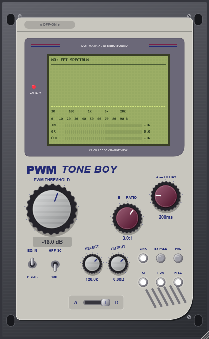

# Ficha técnica — PWM TONE BOY

**Versión 1.4.4 · PAPIELGUAPO · Windows x64**

Compresor mono/estéreo con rodilla suave, recuperación dependiente del programa y color armónico opcional. Diseño propio que combina una referencia funcional de dinámica tipo PIE con ideas de color/PDA/KI del STC-8; no se ha calibrado contra un Crane Song real ni se presenta como réplica certificada.

## Formato y procesamiento

| Característica | Implementación |
|---|---|
| Formatos distribuidos | VST3 y aplicación Standalone |
| Plataforma del binario | Windows de 64 bits |
| Canales | Mono o estéreo; igual número de entradas y salidas |
| Señal | Audio float de 32 bits; coeficientes/estados de biquads en doble precisión |
| Oversampling | 4×, filtros IIR polifásicos de media banda |
| Latencia declarada | 6 muestras |
| Parámetros | 16, con estado guardable en el proyecto |
| Editor | Reescalable del 80% al 200%, proporciones fijas |
| Sample rates | El motor acepta 8–768 kHz como rango de preparación. Regresión DSP a 32/44,1/48/96/192 kHz; nueva validación del analizador a 176,4/192 kHz. No se certifican todas las tasas aceptadas. |

## Dinámica

| Control | Valores |
|---|---|
| THRESHOLD | −42 a 0 dB; inicial −18 dB |
| RATIO | **1:5.0, 1:3.0, 1:2.0, 1:1, 2:1, 3:1, 5:1, 10:1 y LIM**; inicial 3:1 |
| DECAY / recuperación nominal | 100, 200, 400, 800, 1600 y 3200 ms; inicial 200 ms |
| Ataque | Compresión nominal 2,2 ms; PDA puede acortarlo hacia 0,35 ms. **LIM: 0,1 ms** nominal, sin lookahead |
| Recuperación real | Una etapa principal en ganancia; memoria acotada hasta +15% de la constante nominal. Detector con estabilización de picos de 12 ms y caída de 25 ms |
| Auto-Gain | Compensación por umbral/ratio en compresión/LIM; **0 dB fijo en las tres expansiones**. No iguala sonoridad |
| OUTPUT | −24 a +12 dB; inicial 0 dB; después de la protección de picos |
| BYPASS | Señal seca con compensación de latencia y transición suave |
| PAD | Entrada ×0,25, aproximadamente −12,04 dB |
| LINK | Ganancia del compresor 85% compartida / 15% independiente; protección de picos enlazada al activarlo |

Las posiciones 1:5/1:3/1:2 son **expansiones hacia arriba**, con rodilla de 3 dB y realce máximo +24 dB. No hay compresión ascendente UP ni menús EXP/UP, dry/wet interno, ratio/release continuos o escritura numérica por doble clic. Doble clic en una perilla restaura su valor inicial.

## Selector inferior A / D

**A de abajo = ANALOG / analógico. D de abajo = DIGITAL / digital.** Es el selector horizontal, distinto de la etiqueta superior A — DECAY.

- **A:** contorno dinámico, color par/impar suave y variación real muy leve de filtros/ganancia. Sus irregularidades en Linear Analysis dependen de la señal y la estimación entrada/salida.
- **D:** omite la rama adicional de color/deriva de A. Conserva compresión, filtros principales, Auto-Gain y protección de picos: no es bypass.
- **KI:** etapa independiente que añade principalmente segundo armónico sutil; al apagarla, esa etapa se hace lineal. Puede utilizarse en A o D.
- A/D cruza suavemente durante 40 ms. No hay generador de hiss, hum, ruido aleatorio ni dither; entrada cero desde reposo da salida cero. Con señal, A y KI pueden producir armónicos/modulación.

## Filtros y detección

| Elemento | Función |
|---|---|
| EQ IN | Filtro de reconstrucción: 11,2 kHz activado / 20 kHz desactivado |
| HPF SC | Paso alto de 90 Hz en el detector; no recorta directamente el grave del audio |
| H-SC | Preénfasis diferencial y detector híbrido de 65% pico + 35% RMS |
| Filtrado fijo | Paso alto de cuarto orden a 18 Hz y contorno de +0,85 dB a 52 Hz |
| SELECT | Lectura/control heredado de 4–250 kHz; no altera el audio con DAC y sample-and-hold desactivados |
| DAC / ProSound | Degradación y ruta raw desactivadas en audio |

## Pantalla y medición

Seis vistas con clic en la LCD: espectro, KI/18 Hz, rodilla/GR, diagnóstico DAC/PWM heredado, Linear Analysis y Harmonic Analysis. Cambiar de vista no cambia el sonido.

M4 combina modelo y transferencia H1 observada en A. M5 muestra espectros de entrada/salida con música; solo calcula THD/THD+N con un tono válido. Son estimadores internos, no un instrumento de laboratorio certificado. La LCD se refresca a 30 Hz y el ajuste armónico pesado usa un hilo de fondo.

v1.4.3 corrige el cuello de botella de telemetría a 176,4/192 kHz mediante cola y lector de 65.536 posiciones. Un bloqueo suficientemente largo de la interfaz aún puede perder diagnósticos; el audio no se descarta por esa cola.

## Protección y límites

La protección de picos actúa aproximadamente a −0,45 dBFS **antes de OUTPUT**; no es garantía true-peak. OUTPUT positivo puede superar 0 dBFS. Auto-Gain no iguala LUFS ni volumen percibido. No sustituye una comprobación de nivel final.

**Validación:** 3.505 aserciones sin fallos y pluginval nivel 10. Prueba antes/después a 176,4/192 kHz y temporizador JUCE real a 192 kHz, con productor de audio según reloj. No equivale a probar todos los DAWs ni dispositivos físicos.

[Dinámica y pruebas v1.4.4](DINAMICA-v1.4.4.md) · [Guía de uso](GUIA-ES.md) · [Corrección y pruebas](CORRECCION-ANALIZADOR-v1.4.3.md) · [Auditoría base](AUDITORIA-v1.4.2.md)
