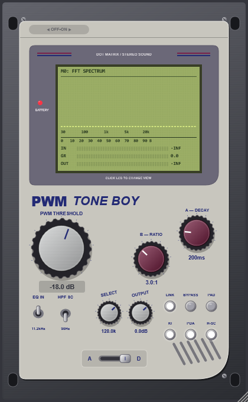
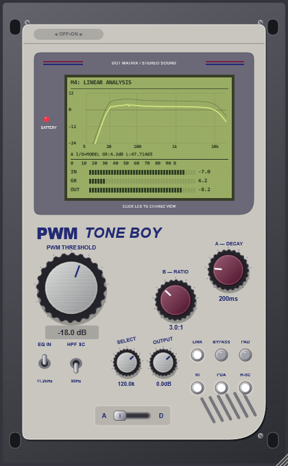
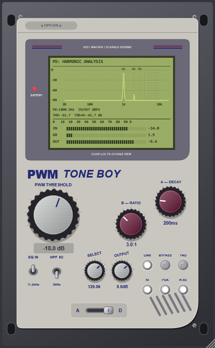

# Guía de uso — PWM TONE BOY v1.4.2

**Creado por PAPIELGUAPO · Windows x64 · VST3 + Standalone**

## Qué hace el plugin

PWM TONE BOY es un compresor estéreo con rodilla suave, recuperación con memoria del programa y color armónico KI opcional. Permite controlar la dinámica con una etapa KI que se vuelve lineal al apagarla; los perfiles A/D conservan su propia coloración. Incluye protección dinámica de picos, filtros de reconstrucción y subgraves, compensación automática de ganancia y ajuste manual OUTPUT.

Es un diseño original inspirado en comportamientos del STC-8. No se ha calibrado contra un equipo Crane Song real y no se presenta como una réplica certificada. La etapa KI apagada es lineal; los filtros, la compresión y el color A/D siguen funcionando.

## Descargar e instalar

1. Descarga **PWM-TONE-BOY-Windows-x64.zip** en la [release v1.4.2](https://github.com/papielguapo/PWMToneBoy/releases/tag/v1.4.2).
2. Descomprime el ZIP. Copia la carpeta completa `VST3/PWM TONE BOY.vst3` a `C:\Program Files\Common Files\VST3`. Cierra los programas que estén usando el plugin antes de sustituirlo. Windows puede solicitar permisos de administrador.
3. Vuelve a escanear los plugins en tu DAW y carga **PWM TONE BOY**, fabricante **PAPIELGUAPO**.
4. Para usarlo sin DAW, abre `Standalone/PWM TONE BOY.exe`.

El ZIP también incluye esta guía, las imágenes de la interfaz y de los nuevos visores, y registros de pruebas. `PWMToneBoy-source.zip` contiene el proyecto CMake y las fuentes para recompilarlo.

## Cómo manejarlo

- **Arrastra una perilla** horizontal o verticalmente para cambiar su valor. Durante el ajuste aparece el valor numérico.
- **Doble clic en una perilla:** vuelve a su valor de fábrica. No reinicia los demás controles.
- **Clic en una palanca o lámpara:** alterna activado/desactivado. Las seis lámparas se iluminan en blanco al estar activas; en BYPASS, una lámpara encendida significa que el procesamiento está puenteado.
- **Clic en la LCD:** cambia de pantalla, en el orden M0 → M1 → M2 → M3 → M4 → M5 → M0. Cambiar la pantalla no cambia el sonido.
- **Arrastra la esquina inferior derecha:** redimensiona del 80% al 200%, manteniendo las proporciones. El plugin recuerda el ancho con el estado del proyecto.
- Mantén el puntero sobre un control para ver su ayuda. La rueda del ratón no modifica las perillas, evitando cambios accidentales.

## Perillas

| Perilla | Qué hace | Rango y valor inicial |
|---|---|---|
| **PWM THRESHOLD** | Fija el umbral del compresor. Al bajarlo, una mayor parte de la señal entra en compresión. La rodilla hace que la transición alrededor del umbral sea gradual. El display inferior muestra dB. | −42 a 0 dB; inicial **−18 dB**. |
| **B — RATIO** | Define la intensidad de la compresión por encima de la rodilla. 1:1 desactiva la reducción del compresor, pero conserva filtros, KI si está activo, Auto-Gain según su fórmula y protección de picos. INF es una relación interna de 100:1. | **1:1, 2:1, 3:1, 5:1, 10:1, 20:1, INF**; inicial **3:1**. |
| **A — DECAY** | Ajusta la recuperación base de la dinámica. Valores cortos recuperan antes y largos mantienen más tiempo la reducción. El tiempo real también depende de la memoria de la compresión: no es un cronómetro fijo de vuelta a cero. | **100, 200, 400, 800 ms, 1.6 y 3.2 s**; inicial **200 ms**. |
| **SELECT** | Control de reloj PWM heredado. Conserva su posición y lectura, pero **no modifica el audio en v1.2.1**, porque sample-and-hold y DAC están desactivados. | 4–250 kHz; inicial **120 kHz**. |
| **OUTPUT** | Sube o baja el nivel procesado después de Auto-Gain y de la protección de picos. No modifica el umbral ni el ratio. Los cambios se suavizan durante 20 ms. Ganancias positivas pueden superar 0 dBFS después de la protección; comprueba el nivel de salida del DAW. En BYPASS se escucha la señal seca, sin OUTPUT. | **−24 a +12 dB**; inicial **0 dB**. |

## Palancas y botones

| Control | Activado | Desactivado | Inicial |
|---|---|---|---|
| **EQ IN** | Filtro de reconstrucción con corte de **11.2 kHz**, para una parte alta más contenida. | Cambia el corte a **20 kHz**; no elimina todo el filtrado del plugin. | Activado. |
| **HPF SC** | Filtra el detector con un paso alto Butterworth a **90 Hz**, reduciendo la influencia de los graves en la compresión. | El detector recibe también los graves sin ese paso alto. No es un corte directo de graves en la ruta de audio. | Desactivado. |
| **LINK** | Comparte el 85% de la ganancia del compresor y mantiene un 15% independiente por canal. La protección de picos se enlaza para cuidar la imagen estéreo. | Compresión y protección de picos independientes por canal. | Activado. |
| **BYPASS** | Escucha la señal seca con el retraso que compensa la latencia del plugin. La transición es suave y el motor continúa actualizando sus estados. BATTERY se apaga. | Escucha la señal procesada. | Desactivado. |
| **PAD** | Atenúa la entrada multiplicándola por **0.25**, aproximadamente **−12.04 dB**, antes del procesamiento. | Entrada sin esa atenuación. | Desactivado. |
| **KI** | Añade una curvatura par sutil, principalmente segundo armónico, dependiente de actividad y compresión. | El waveshaper de la etapa KI es lineal; no quedan ni el antiguo logaritmo del semiciclo positivo ni una saturación permanente en esa etapa. | Activado. |
| **PDA** | Ante riesgo de sobrecarga, acorta el ataque nominal de **2.2 ms** hacia **0.35 ms**. Trabaja junto al control de picos. | Mantiene el ataque nominal sin ese acortamiento dinámico. | Activado. |
| **H-SC** | Activa preénfasis diferencial en el sidechain y mezcla de detección **65% pico + 35% RMS**. Cambia cómo reacciona el compresor; no es un ecualizador directo de la salida. | Usa detección de pico sin ese preénfasis híbrido. | Activado. |

## Selector horizontal A / D

Está en la antigua placa AUTO-GAIN. Un clic alterna entre **A**, a la izquierda, y **D**, a la derecha.

- **D — DIGITAL (valor inicial):** recupera la ruta digital de v1.1.0. Omite completamente los filtros y la saturación adicionales del perfil analógico. La carga de la etapa A no altera el sonido de D.
- **KI sigue siendo independiente.** En D con KI activado se conserva el segundo armónico sutil de la versión anterior; con KI apagado esa etapa es lineal. D no equivale a bypass: el compresor, los filtros principales, Auto-Gain y la protección de picos siguen funcionando según sus controles.
- **A — ANALOG:** concentra el color dinámico. El contorno varía de +0.15 a +1 dB alrededor de 65 Hz y de −0.10 a −0.85 dB alrededor de 8 kHz. Los armónicos suaves pares e impares crecen con el nivel y con la memoria de compresión. Puede combinarse con KI.
- La carga responde en unos 35 ms y se relaja en 650 ms. Su enlace entre canales usa la mayor actividad para evitar diferencias de color entre lados. Son decisiones de diseño, no constantes medidas en hardware Crane Song.
- La conmutación A/D cruza durante **40 ms** y se guarda con el estado del plugin.
- **Sin hiss, hum, ruido aleatorio ni dither:** entrada cero desde reposo produce cero exacto en A y D, también con KI activo. Las etapas asimétricas preceden al filtro de 18 Hz para retirar DC.

**Corrección de v1.2.1:** en v1.2.0 se había añadido color dinámico a D. Se retira esa regresión para recuperar el D anterior y se concentra dicho carácter en A. No cambian los IDs de automatización.

## Auto-Gain y protección de picos

Auto-Gain está siempre activo en la ruta procesada y no tiene botón propio. Su compensación se calcula a partir de umbral y ratio: `(-threshold × (1 − 1/ratio)) × 0.54 dB`. No es una normalización a LUFS ni garantiza que el volumen percibido coincida con bypass. Usa OUTPUT para comparar a oído a un nivel similar.

La protección de picos actúa cerca de −0.45 dBFS antes de OUTPUT, con retención de 0.5 ms y recuperación de 60 ms. Después hay una curva de seguridad que permanece lineal hasta ±0.98. Al final, OUTPUT permite ajustar el volumen manualmente.

El filtrado fijo incluye un paso alto de cuarto orden a **18 Hz** y un contorno de **+0.85 dB a 52 Hz**. No hay generador de ruido ni dither; desde reposo, una entrada de cero produce salida de cero exacto. La latencia declarada es de **6 muestras**.

## LCD: seis pantallas con un clic

La interfaz actualiza sus diagnósticos a 60 Hz. Los títulos históricos permanecen en la skin; describimos aquí qué muestran realmente en esta versión.

| Pantalla | Qué ves y cómo interpretarlo |
|---|---|
| **M0 — FFT SPECTRUM** | Analizador de 48 barras con retención visual de picos. Muestra el espectro de la ruta procesada interna, **después de OUTPUT y de la mezcla de bypass**. Sirve para ver la distribución de frecuencias; no sustituye un analizador de distorsión calibrado. |
| **M1 — KI TRIODE+18Hz** | Traza punteada antes del filtro infrasónico y traza sólida después del paso alto de 18 Hz, ambas antes del contorno de 52 Hz y de la protección final. Permite observar el recentrado tras la etapa de color. **KI:%** es el coeficiente interno de color escalado, no un porcentaje de THD. **G:%** indica actividad de la envolvente cuadrática usada para modular el color; no es un botón de puerta de ruido ni un umbral editable. El nombre TRIODE es histórico, no una afirmación de modelado de válvulas. |
| **M2 — STC-8M KNEE+PDR** | A la izquierda, curva estática de compresión según THRESHOLD/RATIO. A la derecha, historial de reducción de ganancia. Las lecturas indican PDA y H-SC activos/inactivos. **PDR:%** representa la memoria interna del programa: una cifra mayor implica mayor contribución de recuperación prolongada. La curva estática no muestra por sí sola el limitador ni la evolución temporal completa. |
| **M3 — 4BIT DAC+PWM** | Vista de diagnóstico heredada: arriba se dibuja el punto interno de la antigua etapa DAC y abajo un tren PWM ilustrativo. **El DAC y ProSound están desactivados en audio**: no debes esperar escalones de cuantización ni que SELECT cambie el sonido. Las leyendas de DAC/RAW/% pueden reflejar parámetros antiguos conservados por compatibilidad, aunque el DSP los ignore. El tren PWM es una visualización, no una señal adicional enviada al DAW. |

### Variación real de audio en A (v1.4.0)

**A ahora incluye una deriva lenta aplicada a los filtros y a una ganancia muy leve del circuito de audio.** Por eso puede variar la respuesta de un analizador externo, incluso con la LCD cerrada. No se ha activado el DAC ni se ha añadido hiss, hum, dither o ruido aleatorio.

La variación es deliberadamente sutil: límites de ±0.025 dB en el pico de graves, ±0.020 dB en agudos y ±0.006 dB de ganancia global, más una sintonía muy leve. La fase avanza con el procesamiento y no se rebobina al hacer reset/prepare en la misma instancia. En una instancia nueva sí comienza una secuencia nueva. Esto es una aproximación de diseño, no una deriva medida de componentes Crane Song.

**Hay una contrapartida real:** al variar parámetros de audio pueden aparecer bandas laterales. No es un generador de ruido, pero A tampoco es perfectamente invariable. D omite esa etapa y mantiene su sonido limpio. Con cero de entrada desde reposo, ambos modos siguen dando cero exacto. Consulta la [auditoría con medidas y límites](AUDITORIA-v1.4.0.md).

### M4 — LINEAR ANALYSIS: respuesta observada solo en A

**En A**, la curva brillante combina la estimación observada de entrada/salida con el modelo del DSP. Usa las muestras reales del canal 1, alineadas por la latencia del plugin, y estima la transferencia por espectros cruzados H1: `|Sxy| / Sxx`. Por eso puede variar con el programa, la compresión y la coloración que ya están actuando en el audio. No hay oscilador, ruido, movimiento aleatorio ni animación añadida para hacerla temblar.

Se muestra **A I/O+MODEL**. Solo se usa la respuesta observada donde hay excitación suficiente (aproximadamente por encima de −70 dBFS por bin), tres ventanas consecutivas activas y coherencia superior a 0.70. Donde faltan datos fiables se conserva el modelo, en lugar de inventar una medición. Con un único seno, solo las bandas excitadas aportan información real; una señal estable puede producir una curva estable. No se fuerza un temblor permanente.

Las estimaciones proceden de ventanas de 8192 muestras, actualizadas aproximadamente hasta seis veces por segundo. La transición de la curva se suaviza en la interfaz a 60 Hz para no saltar entre ventanas. Esta suavización no modifica el audio.

**En D no se aplica esta nueva visualización observada.** Conserva su modelo de respuesta y la reducción de ganancia real, como en v1.2.1. La ruta digital, KI, PDA y H-SC conservan su comportamiento normal; v1.4.0 añade además protecciones ante muestras inválidas y metadatos de host fuera de rango.

La línea tenue sigue siendo la referencia del modelo sin reducción de compresor/limitador. No es una comparación A frente a D ni un bypass. **GR** es la reducción actual; **L** en A indica carga del perfil analógico, no CPU. Con BYPASS la respuesta se representa plana a 0 dB y no se mezcla una estimación antigua de la señal procesada.

Es una estimación pasiva de un sistema que puede ser no lineal y variar con el tiempo, **no un barrido de laboratorio ni una medida certificada de hardware**. Las pequeñas irregularidades también dependen de ventana, coherencia y contenido de la señal. No se reinterpretan como prueba de que se haya emulado un circuito concreto. El DAC sigue desactivado; no se han añadido errores de cuantización para conseguir movimiento.

### M5 — HARMONIC ANALYSIS: espectro siempre visible

**Con música o multitono también ves el espectro.** La traza oscura muestra la entrada y la brillante la salida final del canal 1, incluidos OUTPUT y BYPASS. Así puedes observar cambios al conmutar KI, PDA, H-SC y A/D. KI y A/D generan color armónico; PDA y H-SC cambian el comportamiento de la dinámica y no son osciladores de armónicos independientes.

El espectro usa FFT de 8192 muestras, escala logarítmica de frecuencia y dBFS. Se retienen los picos de bins dentro de cada columna gráfica para no perder líneas estrechas entre puntos del dibujo. Estas trazas no están normalizadas a la fundamental: un cambio de OUTPUT desplaza la salida verticalmente. La ventana finita puede limitar la lectura de armónicos débiles cerca de una señal fuerte.

Cuando la entrada es un **seno limpio y estable**, se añaden:

- **F0:** fundamental estimada a partir de la entrada.
- **H1–H10:** marcadores en las frecuencias armónicas válidas dentro del rango visible. Se etiquetan H1–H3 para evitar amontonar texto; THD integra los armónicos disponibles hasta H10 por debajo de 0.49 veces la frecuencia de muestreo.
- **THD:** energía estimada de H2–H10 respecto a H1, en dB.
- **THD+N:** residuo de salida después de retirar fundamental y DC, respecto a H1. Incluye ruido que ya venga de la entrada, modulación de ganancia y transitorios; el plugin no introduce un generador de ruido propio.

Con música o tono no válido, las curvas siguen visibles pero THD y THD+N muestran **--**. Con silencio verás NO SIGNAL y el suelo gráfico: no se inventan armónicos. No se inyecta ningún sonido automáticamente.

Para medidas, envía un seno desde tu DAW o carga un WAV de un seno en Standalone. Empieza por 1 kHz a −18 dBFS pico y espera a que compresión y carga se estabilicen. Se necesitan ocho ciclos por ventana (`8 × sampleRate / 8192`: aproximadamente 47 Hz a 48 kHz y 188 Hz a 192 kHz). Se rechazan fundamentales iguales o superiores a una quinta parte de la frecuencia de muestreo y entradas inferiores a aproximadamente −80 dBFS RMS.

La FFT y las medidas se actualizan aproximadamente hasta seis veces por segundo, fuera del callback de audio; la LCD se dibuja a 60 Hz. Las cifras inferiores a −90 dB se muestran como **<-90**. Son estimaciones sin ponderación ni certificación de laboratorio, no equivalentes a todas las funciones de un analizador externo.

### Medidores inferiores, siempre visibles

| Medidor | Lectura |
|---|---|
| **IN** | Pico de la entrada procesada después de PAD, expresado en dBFS. |
| **GR** | Reducción máxima de ganancia observada en el bloque, incluyendo compresor y protección de picos, en dB positivos. En bypass el motor sigue trabajando y este indicador puede seguir mostrando reducción interna. |
| **OUT** | Pico de la salida entregada, después de OUTPUT y de la mezcla de bypass, en dBFS. |

Los medidores son de pico por bloque, no integradores LUFS ni medidores certificados de true peak. `-INF` es la indicación visual del límite inferior de la escala (aproximadamente −100 dB), no una medición de precisión ilimitada. La regla superior es una referencia gráfica y los valores numéricos en dB son la lectura útil para niveles.

## Zonas decorativas y funciones retiradas

La pastilla superior **OFF•ON** es decorativa: no es un interruptor. El bypass real es el botón BYPASS. **BATTERY** es un indicador ligado a bypass; no se pulsa. La placa inferior contiene ahora el selector A/D. Los tornillos, ranuras y el altavoz dibujado no tienen acción al hacer clic.

El jack PHONES/ProSound fue retirado de la interfaz. No existe un botón oculto para activarlo. Los parámetros antiguos `phonesRawMode` y `dacCrush` se conservan para compatibilidad con sesiones y automatización, pero no pueden reactivar esas etapas de audio. OUTPUT es un parámetro nuevo e independiente.

## Standalone: probar sin DAW

En la barra superior:

- **Audio input:** procesa la entrada del dispositivo elegido en Options. El contenedor JUCE silencia inicialmente la entrada para evitar realimentación; la configuración de audio permite ajustarla.
- **Drums loop / 808 Bass loop / Chiptune loop:** selecciona un bucle sintetizado interno para probar el compresor de inmediato.
- **WAV / AIFF:** abre el selector de archivos. Un archivo válido comienza a reproducirse en bucle y selecciona File loop. Cancelar el selector no carga un archivo nuevo.
- **File loop:** reproduce el archivo previamente cargado; primero debes cargar uno con WAV / AIFF.
- **Options**, en el contenedor del Standalone: permite acceder a la configuración de audio y a las funciones de estado que proporciona JUCE.

## Primer ajuste para escuchar el efecto

Empieza con ratio 3:1 y DECAY 200 ms. Baja THRESHOLD hasta ver unos pocos dB de GR; compara KI encendido y apagado. Prueba HPF SC si el bombo o el bajo dominan la reducción. Ajusta OUTPUT para comparar con bypass a un volumen parecido: Auto-Gain no garantiza igualdad perceptiva. Para recuperación más lenta, sube DECAY. Para una acción más fuerte, aumenta RATIO.

## Verificación y alcance

La versión binaria v1.2.1 pasó **3.903 comprobaciones automatizadas y pluginval nivel 10**. Se probaron silencio, estado, mono/estéreo, cambios de parámetros, distintas frecuencias de muestreo, bloques de 1–4097 muestras y cuatro tamaños del editor. Los registros se incluyen en QA. Son pruebas de estabilidad y comportamiento del software, no una certificación de equivalencia con hardware.

En v1.2.1 también se verificaron navegación por seis pantallas, tonos fuera de bins, rechazo de multitono y silencio, coherencia de THD/THD+N, correspondencia entre curva y filtros medidos, persistencia del selector A/D y silencio exacto con A + KI. La latencia sigue siendo de 6 muestras.

### Referencia sonora de D restaurada

El ensayo de regresión vuelve a los resultados de v1.1.0 con un seno de 1 kHz a 0.2 pico, ratio 1:1 y umbral 0 dB: KI OFF por debajo de −100 dB de THD y KI ON aproximadamente −62.03 dB, con segundo armónico dominante. Se comprueba además 250 Hz a 0 dBFS, ratio 2:1, umbral 0 dB y KI/PDA/H-SC apagados. Estas cifras corresponden al ensayo automático; no garantizan la misma THD para cualquier nivel o ajuste, especialmente cuando comprime o limita.

### Verificación de v1.3.0

El código del motor de audio se conserva respecto a v1.2.1. Se comprueban todas las combinaciones de PDA y H-SC en D, con KI apagado y encendido, junto a los ensayos de transparencia, segundo armónico y silencio existentes. La nueva estimación se valida con ganancias/fases conocidas, cambios reales de transferencia, bandas sin excitación, incoherencia y una entrada de banda ancha real procesada por A. Los registros acompañan a la descarga.

**Resultado v1.3.0:** 3.917 comprobaciones con cero fallos y pluginval nivel 10 superado (semilla 1472). D con KI apagado mantuvo THD inferior a −121 dB en las cuatro combinaciones PDA/H-SC del ensayo estable de 1 kHz, ratio 3:1 y umbral −18 dB. Con KI encendido se verifica segundo armónico dominante. Son condiciones de prueba concretas, no una garantía universal de THD ni una medida de un STC-8 real. Los archivos del motor de audio no cambian respecto a v1.2.1.

**Resultado de la auditoría v1.4.0:** 3.935 aserciones con cero fallos y pluginval nivel 10 superado. La variación real de A se midió sin editor; se comprobó D estable, silencio, recuperación de NaN/Inf, continuidad de fase de A entre resets y equivalencia de bloques de 17/511 muestras. [Informe completo](AUDITORIA-v1.4.0.md).

## Título renovado (v1.4.1)

PWM pasa de 22 a 32 puntos, con mayor peso visual y menor separación de TONE BOY. El resto del diseño, los ratios y releases por pasos, el circuito A con transferencia observada y D limpio se mantienen como en v1.4.0. No incluye EXP ni UP.

## Recuperación del último analizador A (v1.4.2)

Se recuperan DotMatrixLCDComponent y HarmonicAnalysisWorker del último estado anterior a la vuelta atrás (v1.6.0), adaptando la consulta del ratio a las siete posiciones originales. La estimación H1 y la curva A I/O+MODEL se conservan tal como estaban: sus irregularidades dependen de la señal de entrada y de la transferencia observada. No se inventa movimiento en bandas sin excitación ni se añaden osciladores gráficos.

La versión recuperada calcula el ajuste armónico en un hilo del editor, descarta resultados de contextos anteriores y refresca la LCD a 30 Hz. Incluye la textura de puntos en caché. Se conserva el título PWM ampliado, D limpio, ratio/release por pasos y los 16 parámetros originales. No incluye EXP ni UP ni parámetros continuos. El circuito de audio A no requería otro cambio respecto a v1.4.0; esta recuperación trae el analizador posterior.

Validación v1.4.2: 3.940 aserciones sin fallos; análisis armónico en segundo plano equivalente a la referencia y rechazo de resultados antiguos. Se comprobaron las referencias anteriores de A/D, silencio, seis vistas y tamaños de editor. Los archivos de análisis se compararon con v1.6.0: coinciden salvo la adaptación del acceso al ratio por pasos.
